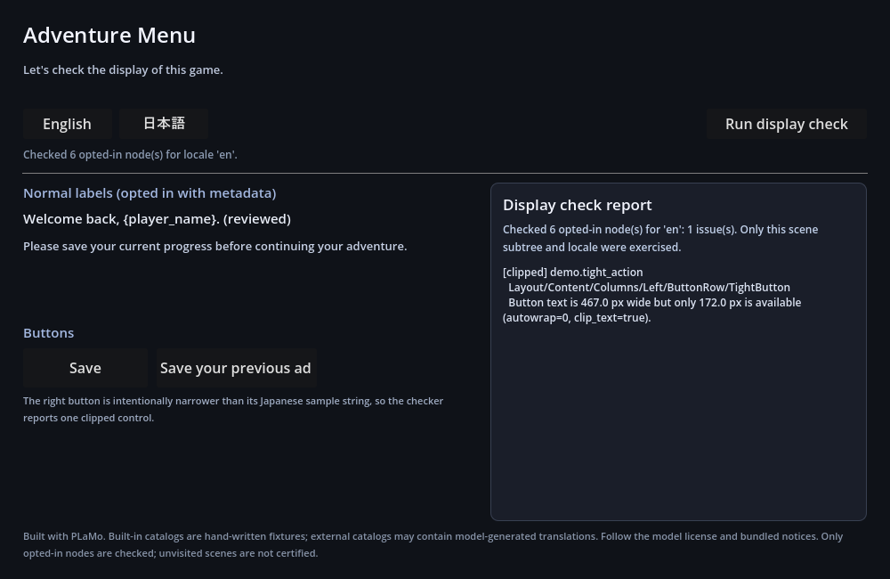

# game-l10n-updater

[日本語](README.md) | English

A CLI for translating game text. It sends only the source text that was added or changed to a local translation API, and updates `targets/<locale>.json` and the state file. Manually edited translations are preserved, and entries whose source also changed are reported as `needs_review`.

The translation API comes from a separate project, [local-jp-translate](https://github.com/marvelousu/local-jp-translate). For Godot, the repository also includes an add-on and a sample that check whether translations fit inside buttons and labels.

## Download and extract

Download the file for your OS from [GitHub Releases](https://github.com/marvelousu/game-l10n-updater/releases/latest) and extract it.

| OS / CPU | File suffix |
| --- | --- |
| Windows amd64 | `windows_amd64.zip` |
| Linux amd64 | `linux_amd64.tar.gz` |
| macOS arm64 | `darwin_arm64.tar.gz` |

When you extract the Windows zip, the folder inside contains `gamel10n.exe`, `examples/`, `docs/`, and other files. The Windows examples below are run from that folder. You do not need to configure PATH or install Go or Python.

On Linux and macOS, the executable is named `gamel10n`. Replace `.\gamel10n.exe` in the command examples with `./gamel10n`.

## Try it without the translation API

`examples/quickstart/` contains four Japanese entries, their English translations, and a state file. You can check translation targets, validate placeholders, and export CSV without setting up an API or model.

```powershell
.\gamel10n.exe plan -config examples\quickstart\gamel10n.json
.\gamel10n.exe check -config examples\quickstart\gamel10n.json -report quickstart-check.json
.\gamel10n.exe export -config examples\quickstart\gamel10n.json -format csv -out quickstart.csv
Get-Content .\quickstart.csv -Encoding utf8
```

`plan` checks whether translation is needed. This sample already contains translations, so `api_requests=0`. The `check` result is as follows.

```text
check: checked=4 errors=0 warnings=0 structural=0 display=0
```

`quickstart.csv` contains the following. You can also confirm that `{name}` remains in both the source and the translation.

```csv
keys,ja,en
menu.new_game,はじめから,New Game
menu.quit,終了,Quit
ui.greet,こんにちは、{name}さん！,"Hello, {name}!"
ui.potion,ポーションを1個手に入れた。,You got a potion.
```

On Linux and macOS, use the following commands.

```sh
./gamel10n plan -config examples/quickstart/gamel10n.json
./gamel10n check -config examples/quickstart/gamel10n.json -report quickstart-check.json
./gamel10n export -config examples/quickstart/gamel10n.json -format csv -out quickstart.csv
cat quickstart.csv
```

## Translate game text

Start the translation API by following the steps in the [local-jp-translate English README](https://github.com/marvelousu/local-jp-translate/blob/main/README.en.md). The default endpoint is `http://127.0.0.1:8787`. This CLI uses loopback connections only.

Create a separate project.

```powershell
.\gamel10n.exe init -dir my-game-l10n -source-lang ja -languages en
```

The following files are created in `my-game-l10n/`. `source/catalog.json` is empty source data.

```text
gamel10n.json
source/catalog.json
targets/en.json
state/gamel10n-state.json
```

Replace `my-game-l10n/source/catalog.json` with the following content.

```json
{
  "schema_version": 1,
  "entries": [
    {
      "key": "ui.greet",
      "text": "こんにちは、{name}さん！",
      "context": "title screen greeting"
    },
    {
      "key": "ui.potion",
      "text": "ポーションを1個手に入れた。",
      "context": "item pickup message"
    }
  ]
}
```

Use `plan` to check the translation targets. `new=2` means that two entries are untranslated and two API calls are needed.

```powershell
.\gamel10n.exe plan -config my-game-l10n\gamel10n.json
```

```text
plan: new=2 changed=0 unchanged=0 deleted=0 needs_review=0 api_requests=2
  new          en       ui.greet (target is missing)
  new          en       ui.potion (target is missing)
```

Translate with `sync`.

```powershell
.\gamel10n.exe sync -config my-game-l10n\gamel10n.json
```

```text
sync success: api_calls=2 wrote_files=true new=2 changed=0 unchanged=0 needs_review=0 deleted=0 pruned=0
  translated en       ui.greet = Hello, {name}!
  translated en       ui.potion = I got one potion.
```

The translations above are the result of running PLaMo 3 Translate 0.8B.

The following two files change at this point. `gamel10n.json` and `source/catalog.json` do not change.

- `my-game-l10n/targets/en.json`
- `my-game-l10n/state/gamel10n-state.json`

You can run `check` and `export` on the same project.

```powershell
.\gamel10n.exe check -config my-game-l10n\gamel10n.json
.\gamel10n.exe export -config my-game-l10n\gamel10n.json -format csv -out my-game.csv
```

Placeholder validation has also passed by the time `sync` succeeds. If `max_length` is not set, `check` ends with the following summary.

```text
check: checked=2 errors=0 warnings=0 structural=0 display=0
```

`my-game.csv` contains a `keys,ja,en` header and two rows. The English column contains the translations returned by the API.

## Changed source text and retranslation

| Change | Next `sync` |
| --- | --- |
| A key is added to the source | Translate the added key |
| `text` is changed for an auto-translated key | Retranslate that key |
| A manually corrected, approved, or locked translation exists | Keep the translation. If the source also changed, report `needs_review` |
| No change | Do not call the API, and do not change the translation data or state |
| A key is deleted from the source | Report only by default. Delete with an explicit `-prune-deleted` |

Placeholder validation checks `{name}`, `%d`, and the names and counts of corresponding HTML / BBCode tags. Broken translations are not applied. Read the translations to check whether the meaning and tone fit the game.

For example, if you change "ポーションを1個手に入れた。" in `my-game-l10n/source/catalog.json` to "ポーションを2個手に入れた。", the next `sync` retranslates only `ui.potion`. The translation from that run was `I got two potions.`

```text
plan: new=0 changed=1 unchanged=1 deleted=0 needs_review=0 api_requests=1
  unchanged    en       ui.greet (source and target unchanged)
  changed      en       ui.potion (source text changed)
```

Change detection uses `text`. Changing only `context` or `max_length` does not trigger retranslation.

## Correct and approve translations

If you edit `targets/en.json` directly, the next `sync` keeps it as a manually corrected translation. If the source also changed, it reports `needs_review` while keeping the translation. After reviewing and correcting the content, specify the key and approve it. `-lock` locks the translation, and `unlock` removes the lock.

```powershell
.\gamel10n.exe approve -config my-game-l10n\gamel10n.json -locale en -key ui.greet
.\gamel10n.exe approve -config my-game-l10n\gamel10n.json -locale en -key ui.greet -lock
.\gamel10n.exe unlock -config my-game-l10n\gamel10n.json -locale en -key ui.greet
```

If even one translation fails placeholder validation, `sync` exits without saving the translation data or state. Enter a translation for that key manually in `targets/<locale>.json`, approve that key with `approve`, and run `sync` again. The approved translation is kept, and the remaining keys are translated.

If you want to review and correct in CSV, you can also use `export` and `import-csv`. Importing into existing data, approval and locking, and protection when saving are covered in [operation details (Japanese)](docs/usage.md).

## Check the display in Godot



This is the running sample with PLaMo's English translations and manually corrected translations loaded. The narrow button on the right is intentionally set up so the text is cut off.

Open the included `godot/` in Godot 4.x to run the sample. The add-on measures `Label`s with translation keys, regular `Button`s, and `RichTextLabel`s using the actual font and display area.

```powershell
.\gamel10n.exe check -config my-game-l10n\gamel10n.json -display-report reports\godot-display.json
```

Importing the Godot display report lets you check keys with cut-off text against the translation files. See [Godot integration (Japanese)](docs/godot-integration.md) and [add-on usage (Japanese)](godot/README.md) for setup and how to create reports.

## Scope

- API connections are limited to loopback.
- Placeholder validation covers the corresponding basic syntax. It does not check ICU MessageFormat, all formats, or tag nesting relationships.
- Godot validation covers the corresponding UI parts in the specified scene. It does not automatically walk through the entire game.
- Translation with the real model and display in Godot 4.7.2 have been verified on Windows. Real inference and real rendering on Linux and macOS are unverified.
- Errors detected during saving are rolled back. Simultaneous updates of multiple files are not guaranteed against power loss or forced termination.

Exit codes are `0` for success, `1` for execution error, `2` for usage error, `3` for structural error, and `4` for display error.

## Build from source

Go 1.23 or later is required. The only dependency is the Go standard library. Go is not required if you only want to try the released version.

```sh
go build -trimpath -o bin/gamel10n ./cmd/gamel10n
go test ./...
go vet ./...
```

`go test ./...` runs without starting the translation API or Godot.

On Windows, use `bin/gamel10n.exe` as the output name. Examples of source text and translations that work without a model are in `examples/quickstart/` and `examples/sample/`.

Release artifacts can be generated with `scripts/package.ps1` on Windows and `scripts/package.sh` on Linux and macOS.

## License

The source code is [MIT](LICENSE). Translations use PLaMo 3 Translate (Built with PLaMo). Model weights are not bundled. The PLaMo model and its outputs are covered by the [PLaMo Community License](LICENSES/PLAMO-en.txt); non-commercial use such as personal, hobby, and academic use is free and requires no registration. Commercial use requires prior registration and is subject to conditions based on revenue scale.

See [THIRD_PARTY_NOTICES.md](THIRD_PARTY_NOTICES.md) (Japanese) for details.
