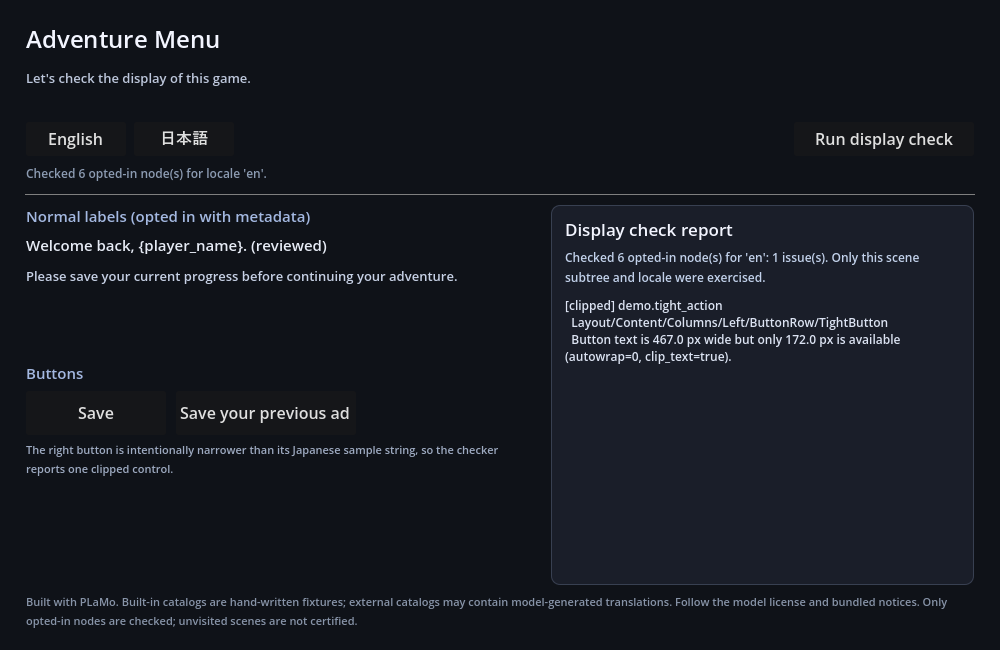

# game-l10n-updater

ゲームの原文を追加・変更した分だけローカルで翻訳するCLIです。手動で修正した訳を保持し、原文も変わった箇所は要確認として報告します。

翻訳には別途 [local-jp-translate](https://github.com/marvelousu/local-jp-translate) を使います。Godot向けには、訳文がボタンやラベルに収まるか確認するアドオンとサンプルも付属します。

**Built with PLaMo** · ソースコードは [MIT](LICENSE) · モデル重みは同梱しません。

## 更新のたびに何が変わるか

| 原文や訳文の変更 | 次の `sync` の動作 |
| --- | --- |
| 日本語の説明文を追加 | 追加した文章を翻訳 |
| 自動訳のままの文章で、原文を変更 | その文章を再翻訳 |
| 手動で修正・承認・ロックした訳がある | 訳を保持。原文も変わっていれば `needs_review` と報告 |
| 変更なし | 再翻訳せず、ファイルも変更しない |
| 原文からキーを削除 | 既定では報告のみ。訳を削除する場合は `-prune-deleted` を明示 |

`{name}`、`%d`、対応するHTML / BBCodeタグの名前・個数も検査します。壊れた訳は適用しません。意味や口調がゲームに合うかは、訳文を読んで確認してください。

## ダウンロード

[GitHub Releases](https://github.com/marvelousu/game-l10n-updater/releases/latest) からOSに合うファイルを取得します。

| OS / CPU | ファイル末尾 |
| --- | --- |
| Windows amd64 | `windows_amd64.zip` |
| Linux amd64 | `linux_amd64.tar.gz` |
| macOS arm64 | `darwin_arm64.tar.gz` |

展開した `gamel10n.exe`（Linux / macOSでは `gamel10n`）をPATHの通ったフォルダに置きます。実行にGoやPythonは不要です。チェックサムはリリースに添付した `SHA256SUMS.txt` で確認できます。

## 最初の翻訳

先に [local-jp-translateのREADME](https://github.com/marvelousu/local-jp-translate#readme) に従って翻訳APIを起動します。既定の接続先は `http://127.0.0.1:8787` です。

以下はPowerShellの例です。Linux / macOSでも同じ引数を使えます。

```powershell
gamel10n init -dir my-game-l10n -source-lang ja -languages en
cd my-game-l10n
```

設定と空の翻訳ファイルができます。

```text
gamel10n.json
source/catalog.json
targets/en.json
state/gamel10n-state.json
```

`source/catalog.json` に原文を書きます。

```json
{
  "schema_version": 1,
  "entries": [
    {
      "key": "ui.greet",
      "text": "こんにちは、{name}さん！",
      "context": "title screen greeting",
      "max_length": 24
    }
  ]
}
```

`key` は文章のID、`context` は翻訳時の補足です。`max_length` は文字数の目安で、画面上の幅はGodot側で確認します。`context` と `max_length` は省略できます。

```powershell
# 翻訳する文章を確認（APIは呼ばない）
gamel10n plan -config gamel10n.json

# 追加・変更した文章を翻訳して保存
gamel10n sync -config gamel10n.json

# キーとプレースホルダーを検査
gamel10n check -config gamel10n.json

# Godotで使える翻訳CSVを書き出す
gamel10n export -config gamel10n.json -format csv -out game.csv
```

英訳は `targets/en.json` に保存されます。以降は原文を編集して、同じ `plan` → `sync` → `check` を実行します。設定・ファイル形式の詳細は [スキーマ](docs/schemas.md) を参照してください。

## 訳文を修正する

`targets/en.json` を編集すると、次回の更新では手動で修正した訳として保持されます。確認が済んだ訳は、キーを指定して承認できます。

```powershell
gamel10n approve -config gamel10n.json -locale en -key ui.greet
```

原文も変わった場合は、修正済みの訳を残して `needs_review` と報告します。内容を確認して再度承認すると解除されます。

CSVで確認・修正したい場合は `export` と `import-csv` も使えます。既存データへの取り込み、承認・ロック、保存時の保護は [操作の詳細](docs/usage.md) にまとめています。

## Godotで表示を確認する



PLaMoの英訳と手動で修正した訳を読み込んだ実行画面です。右側の狭いボタンは、意図的に文字が切れるようにしてあります。

付属の `godot/` をGodot 4.xで開くと、サンプルを実行できます。アドオンは、翻訳キーを指定した `Label`、通常の `Button`、`RichTextLabel` を、実際のフォントと表示領域で測ります。

```powershell
gamel10n check -config gamel10n.json -display-report reports/godot-display.json
```

Godotの表示レポートを取り込むと、文字切れのあるキーを翻訳ファイルと対応付けて確認できます。導入とレポートの作り方は [Godot連携](docs/godot-integration.md) と [アドオンの使い方](godot/README.md) を参照してください。

## 対応範囲

- APIへの接続はループバック限定です。
- 原文の変更判定は `text` が対象です。`context` や `max_length` だけを変えても再翻訳しません。
- プレースホルダー検査は対応する基本構文が対象です。ICU MessageFormatやすべての書式、タグの入れ子関係を検査するものではありません。
- Godotの検査対象は、指定したシーン内の対応するUI部品です。ゲーム全体を自動巡回しません。
- Windowsで実モデルの翻訳とGodot 4.7.2の表示を確認しています。Linux / macOSの実推論・実描画は未確認です。
- 保存中に検知したエラーでは元に戻します。電源断や強制終了に対する複数ファイルの同時更新は保証しません。

終了コードは、成功 `0`、実行エラー `1`、使い方の誤り `2`、構造エラー `3`、表示エラー `4` です。

## ソースからビルドする

Go 1.23以上が必要です。依存はGo標準ライブラリのみです。

```sh
go build -trimpath -o bin/gamel10n ./cmd/gamel10n
go test ./...
go vet ./...
```

Windowsでは出力名を `bin/gamel10n.exe` にします。モデルなしで試せる原文・訳文の例は `examples/sample/` にあります。

配布物はWindowsで `scripts/package.ps1`、Linux / macOSで `scripts/package.sh` を使って生成できます。

## ライセンス

ソースコードはMITです。PLaMoモデルとその出力には別のPLaMo Community Licenseが適用されます。商用利用には事前登録と売上規模の条件があります。モデルのライセンス本文を `LICENSES/` に同梱しています。

詳細は [THIRD_PARTY_NOTICES.md](THIRD_PARTY_NOTICES.md) を確認してください。
